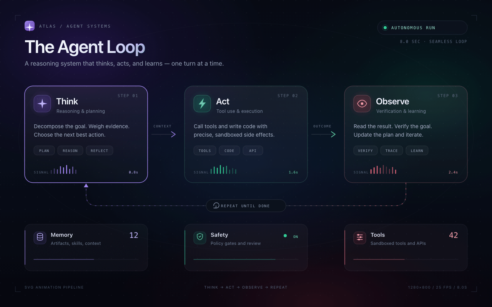
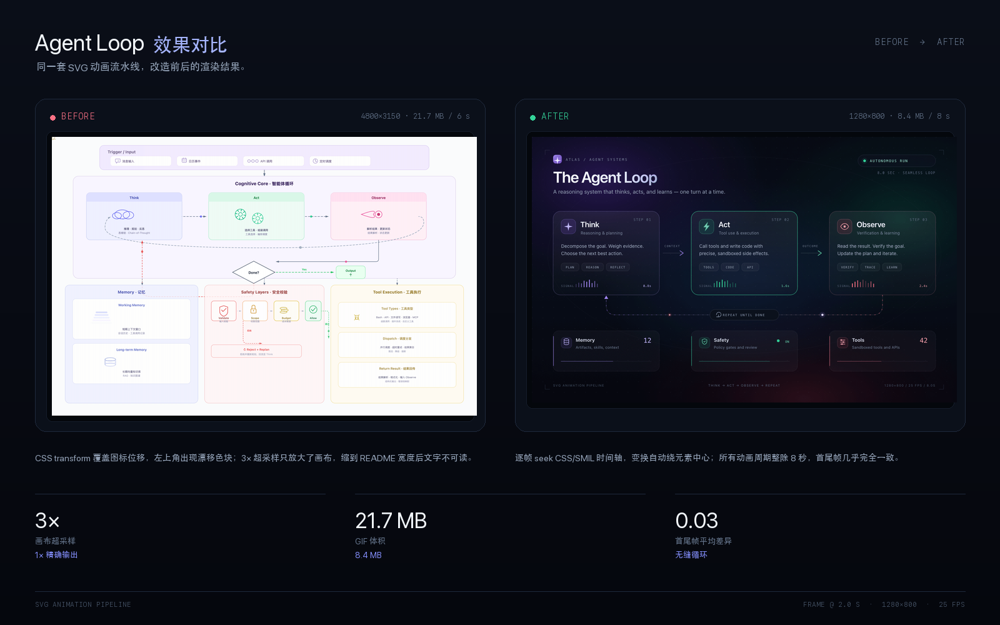

<p align="center">
  
</p>

# SVG Animation Pipeline

端到端 SVG 动画流水线：**自然语言描述 → LLM 生成 SVG → 程序化动画 → 按帧渲染 → FFmpeg 合成**

同一份 SVG 每次渲染得到相同帧，原生 CSS/SMIL 动画会被精确 seek 到帧时间，因此可以稳定输出**循环无缝、可复现**的 GIF/MP4/WebM。本仓库同时提供 DeepSeek Harness 插件 **SVG Motion**。

<p align="center">
  
</p>
<p align="center">
  <sub>1280×800 · 25 FPS · 8s seamless loop · 200 frames · <a href="./output/agent-loop.mp4">MP4 版（569 KB）</a> · <a href="./examples/agent-loop.ts">源码</a></sub>
</p>

## 效果对比



左边是旧版渲染：`quality: 'high'` 把画布放大到 4800×3150，GIF 达到 21.7 MB；更关键的是，CSS `transform` 覆盖了图标自身的 `transform` 属性，左上角出现漂移色块，9–12px 的文字缩到 README 宽度后不可读。

右边是改造后的 1280×800 / 25fps / 8s 无缝循环版本。主要变化：

- 动画时间轴改为**逐帧 seek**：CSS `document.getAnimations()` 与 SVG SMIL 都暂停后设置到 `frame / fps`，不再依赖真实墙钟
- `transform` 与元素原有 `transform` **组合**，`scale`/`rotate` 未指定中心时自动绕 bbox 中心
- presentation 属性以 **kebab-case 内联样式**写入，`stroke-dashoffset` 等动画不再被 class CSS 覆盖
- 路径形变支持完整 SVG path 指令（含圆弧），按等弧长采样并对齐起点/方向
- `width`/`height` 就是最终尺寸，`quality` 不再偷偷放大画布
- GIF 使用全序列调色板 + `stats_mode=diff` + `sierra2_4a`，并显式 `-loop 0`

## 核心特性

- **LLM 智能生成**：支持 OpenAI/Anthropic API，自然语言描述自动生成 SVG 动画
- **DSH 插件**：注册 `svg_motion_render` 工具，Agent 在对话里直接产出 GIF/MP4/WebM，输入输出跟随会话工作目录
- **确定性逐帧渲染**：CSS 动画与 SMIL 统一暂停并 seek 到帧时间，同一输入重复渲染结果一致
- **原生动画保留**：`preserveNativeAnimations: true` 时保留 `@keyframes`、SMIL 动画，并逐帧同步两条时间轴
- **正确属性通道**：presentation 属性走 kebab-case 内联样式，避免被 class CSS 覆盖；变换会与作者 transform 组合
- **自动变换中心**：`scale` / `rotate` 未指定中心时绕元素 bbox 中心，不再绕 SVG 原点跳动
- **路径形变**：解析 M/L/H/V/C/S/Q/T/A/Z，等弧长采样、起点与方向对齐，circle ↔ star 不再产生乱线
- **程序化动画**：关键帧引擎，24 种缓动函数，变换/颜色/路径/数值插值
- **分辨率可控**：`width`/`height` 为最终尺寸，`pixelRatio` 单独控制超采样；`quality` 只影响视频编码
- **更干净的 GIF**：全序列 palette、`stats_mode=diff`、`sierra2_4a`、`-loop 0`
- **工程化细节**：唯一临时目录、`finally` 自动清理、帧序列校验、输出目录自动创建
- **前端界面**：React + Vite 可视化编辑器，实时预览

## 快速开始

### 安装

```bash
# 主项目
npm install

# 后端 API
cd server && npm install && cd ..

# 前端界面
cd frontend && npm install && cd ..
```

### 环境要求

- Node.js 18+
- FFmpeg（通过 `@ffmpeg-installer/ffmpeg` 自动安装）
- OpenAI 或 Anthropic API Key（仅 LLM 生成模式需要）

如果 Puppeteer 无法下载 Chrome，可直接复用系统 Chrome：

```bash
export PUPPETEER_EXECUTABLE_PATH="/Applications/Google Chrome.app/Contents/MacOS/Google Chrome"
```

### 启动

```bash
# 终端 1：启动后端 API
cd server && npm run dev

# 终端 2：启动前端界面
cd frontend && npm run dev

# 访问 http://localhost:3000
```

## 使用方式

### 方式 1：LLM 自动生成（推荐）

```typescript
import { SVGAnimationPipeline } from 'svg-animation-pipeline';

const result = await SVGAnimationPipeline.fromDescription({
  description: '创建一个用户认证流程图，包含登录、验证、授权三个步骤',
  style: 'ppt-flat',
  llmConfig: {
    provider: 'openai',  // 或 'anthropic'
    apiKey: 'sk-...',
  },
  outputConfig: {
    output: './output/auth-flow.gif',
    fps: 30,
    duration: 6000,
  },
});

console.log('Output:', result.output);
console.log('Frames:', result.frames);
```

### 方式 2：手动定义动画

```typescript
import { SVGAnimationPipeline } from 'svg-animation-pipeline';

const pipeline = new SVGAnimationPipeline({
  input: 'logo.svg',  // 或 SVG 内容字符串
  output: 'output.gif',
  fps: 30,
  duration: 2000,
  width: 800,
  height: 600,
});

pipeline.addAnimation({
  targets: '#stroke-layer',
  keyframes: [
    { time: 0, properties: { strokeDashoffset: 1000, opacity: 0 } },
    { time: 1000, properties: { strokeDashoffset: 0, opacity: 1 } },
  ],
  easing: 'easeInOutQuad',
});

pipeline.on('progress', (progress) => {
  console.log(`${progress.percent}% - ${progress.message}`);
});

await pipeline.render();
```

### 方式 3：LLM 单独调用

```typescript
import { LLMOrchestrator } from 'svg-animation-pipeline';

const orchestrator = new LLMOrchestrator({
  provider: 'openai',
  apiKey: 'sk-...',
});

const result = await orchestrator.generateDiagram({
  description: '系统架构图，展示微服务之间的调用关系',
  style: 'ppt-flat',
  dimensions: { width: 1400, height: 950 },
});

console.log('SVG:', result.svg);
console.log('Animations:', result.animations);
```

## DeepSeek Harness 插件

本仓库同时是一个可安装的 **DSH 插件**，名字是 **SVG Motion**。它把渲染流水线注册为 `svg_motion_render` 工具，让 DSH 里的 Agent 直接生成 GIF / MP4 / WebM，而不是只输出一段 SVG 代码。

插件是 host-only 的：不修改 Web UI，不额外启动服务。安装后重启 DSH，工具会出现在 Agent 的工具列表中。

### 安装

要求 **DSH >= 0.2.2-rc.1**、Node.js 18+，以及可用的 Chrome/Chromium；FFmpeg 已随包提供。

```bash
dsh plugin --profile web add \
  https://github.com/atlasmarkz/svg-animation-pipeline/releases/download/v1.1.2/svg-animation-pipeline-1.1.2.tgz
```

### 工具调用

```json
{
  "svg": "<svg xmlns=\"http://www.w3.org/2000/svg\" width=\"1280\" height=\"800\">...</svg>",
  "output": "output/agent-loop.gif",
  "fps": 25,
  "duration": 8000,
  "preserveNativeAnimations": true,
  "quality": "high",
  "pixelRatio": 1
}
```

也可以传 `input: "assets/loop.svg"` 读取文件，或用 `animations` 传入关键帧数组：

```json
{
  "input": "assets/card.svg",
  "output": "output/card.mp4",
  "fps": 30,
  "duration": 1800,
  "animations": [
    {
      "targets": "#card",
      "keyframes": [
        { "time": 0, "properties": { "opacity": 0, "transform": { "translate": [0, 12] } } },
        { "time": 600, "properties": { "opacity": 1, "transform": { "translate": [0, 0] } }, "easing": "easeOutCubic" }
      ]
    }
  ]
}
```

`output` 支持 `.gif`、`.mp4`、`.webm`；相对路径按**当前 DSH 会话工作目录**解析，输入文件也通过会话文件系统读取。Chrome 会优先使用 `chromePath` / `PUPPETEER_EXECUTABLE_PATH` / 系统安装的 Chrome。

### 参数

| 参数 | 类型 | 默认值 | 说明 |
|------|------|--------|------|
| `svg` | string | — | 内联 SVG，与 `input` 二选一 |
| `input` | string | — | `.svg` 文件路径，与 `svg` 二选一 |
| `output` | string | 必填 | 输出路径，扩展名决定格式 |
| `width` / `height` | number | SVG 尺寸 | 输出画布尺寸，16–4096 |
| `fps` | number | 25 | 1–60 |
| `duration` | number | 4000 | 动画时长，100–60000 ms |
| `background` | string | `#ffffff` | 背景色 |
| `quality` | `low` \| `medium` \| `high` | `medium` | 只影响 MP4/WebM 编码 |
| `pixelRatio` | number | 1 | 0.25–4；`2` 输出 2× 尺寸 |
| `preserveNativeAnimations` | boolean | true | 保留并逐帧 seek CSS/SMIL |
| `animations` | AnimationConfig[] | — | 关键帧动画，格式见上 |
| `chromePath` | string | 自动检测 | Chrome/Chromium 可执行文件 |
| `keepFrames` | boolean | false | 保留 PNG 帧，便于调试 |

单次渲染限制：最多 1200 帧、捕获像素不超过 2400 万。工具返回输出路径、尺寸、帧数、耗时和文件大小。

### 市场

插件条目已提交到 DSH 社区市场索引 [awesome-dsh-plugin](https://github.com/awesome-dsh-plugin/awesome-dsh-plugin)（[PR #14692](https://github.com/awesome-dsh-plugin/awesome-dsh-plugin/pull/14692)）。合并后可以直接在 dsh-market 搜索 **SVG Motion**；在那之前，用上面的 Release tarball 安装即可。

## 支持的样式

| 样式 | 描述 | 适用场景 |
|------|------|----------|
| `ppt-flat` | 白色背景，马卡龙配色，细线条，圆角 | 商务 PPT、技术文档 |
| `dark-tech` | 深色背景，霓虹色，发光效果 | 技术演示、黑客风格 |
| `academic` | 纯白背景，衬线字体，专业风格 | 学术论文、研究报告 |
| `hand-drawn` | 手绘风格，粗线条，活泼配色 | 教学材料、创意展示 |

## 支持的 LLM 提供商

| 提供商 | 模型 | 说明 |
|--------|------|------|
| OpenAI | GPT-4o, GPT-4-turbo | 推荐 GPT-4o |
| Anthropic | Claude 3.5 Sonnet, Claude 3 Opus | 推荐 Claude 3.5 Sonnet |

## API 参考

### SVGAnimationPipeline

```typescript
new SVGAnimationPipeline(config: PipelineConfig, events?: PipelineEvents)
```

#### 配置项

| 选项 | 类型 | 默认值 | 描述 |
|------|------|--------|------|
| `input` | `string` | 必填 | SVG 文件路径或 SVG 内容字符串 |
| `output` | `string` | 必填 | 输出文件路径 (.gif, .mp4, .webm) |
| `fps` | `number` | 30 | 帧率 |
| `duration` | `number` | 必填 | 动画时长（毫秒） |
| `width` | `number` | 800 | 渲染宽度（像素） |
| `height` | `number` | 600 | 渲染高度（像素） |
| `background` | `string` | '#ffffff' | 背景颜色 |
| `quality` | `'low' \| 'medium' \| 'high'` | `'medium'` | MP4/WebM 编码质量；不改变分辨率 |
| `pixelRatio` | `number` | 1 | 帧捕获超采样倍率；`2` 会输出 2× 尺寸的帧 |
| `preserveNativeAnimations` | `boolean` | false | 保留并逐帧 seek CSS/SMIL 动画 |
| `tempDir` | `string` | 系统临时目录 | 自定义帧文件目录 |
| `keepFrames` | `boolean` | false | 保留 PNG 帧，便于调试或二次编码 |
| `executablePath` | `string` | 自动检测 | Chrome/Chromium 可执行文件；也可用 `PUPPETEER_EXECUTABLE_PATH` |

#### 方法

- `addAnimation(config)` - 添加动画配置
- `addAnimations(configs)` - 批量添加动画
- `setStyles(css)` - 注入 CSS 样式
- `on(event, handler)` - 注册事件处理器
- `render()` - 执行渲染流水线
- `getLayers()` - 获取 SVG 图层
- `getParsedSVG()` - 获取 SVG 元数据
- `getTempDir()` - 获取本次渲染的帧目录
- `close()` - 关闭浏览器资源

#### 静态方法

- `SVGAnimationPipeline.fromDescription(request)` - LLM 自动生成并渲染

### 分辨率、质量与循环

- `width` / `height` 决定最终帧尺寸。`pixelRatio: 2` 会输出 2× 帧（例如 800×600 → 1600×1200），适合高 DPI 素材或后续缩放；它不会改变布局。
- `quality` 只映射到视频编码质量：MP4 CRF 18/21/25，WebM CRF 30/33/37（high/medium/low）。GIF 固定使用 256 色全局调色板。
- 要得到无缝 GIF，让所有 CSS/SMIL 周期整除 `duration`，并让第一帧与最后一帧状态一致。渲染器会把原生时间轴 seek 到每帧时间，而不是按实际耗时采样，所以机器快慢不会改变动画相位。

#### 与旧版的行为差异

- `quality` 不再放大画布。旧版 `high` 会得到 3× 尺寸；现在请用 `pixelRatio` 显式控制超采样。
- `preserveNativeAnimations` 默认改为 `false`。需要保留 CSS/SMIL 动画时请显式开启。
- 临时帧默认写入系统临时目录，并在 `render()` 结束后清理；需要保留时设 `keepFrames: true`。

### AnimationConfig

```typescript
{
  targets: string | string[],   // CSS 选择器
  keyframes: Keyframe[],        // 关键帧数组
  easing?: EasingType,          // 缓动函数
}
```

### Keyframe

```typescript
{
  time: number,                  // 时间（毫秒）
  properties: AnimatableProperties,
  easing?: EasingType,
}
```

### 缓动函数

| 名称 | 描述 |
|------|------|
| `linear` | 匀速 |
| `easeIn`, `easeOut`, `easeInOut` | 基础缓动 |
| `easeInQuad` ~ `easeInOutQuint` | 二次到五次缓动 |
| `easeInSine` ~ `easeInOutSine` | 正弦缓动 |
| `elastic`, `easeOutElastic` | 弹性缓动 |
| `bounce` | 弹跳缓动 |
| `spring` | 弹簧缓动 |

### 可动画属性

- `opacity` - 透明度 (0-1)
- `strokeDashoffset` / `strokeDasharray` - 描边动画
- `transform` - 变换 (translate, rotate, scale, skew)；未指定中心时 `scale`/`rotate` 自动绕 bbox 中心
- `d` - 路径形变 `{ start, end }`
- `fill` / `stroke` - 颜色（自动插值）
- `strokeWidth`, `fillOpacity`, `strokeOpacity`

## 流水线架构

```
┌─────────────────────────────────────────────────────────────────┐
│  Phase 1: 分层 (SVG Layering)                                   │
│  ┌──────────────┐    ┌──────────────┐    ┌──────────────────┐   │
│  │  SVG Loader  │───▶│  Validator   │───▶│  Layer Parser    │   │
│  └──────────────┘    └──────────────┘    └──────────────────┘   │
│                                                                  │
│  Phase 2: 动画 (Procedural Animation)                            │
│  ┌──────────────┐    ┌──────────────┐    ┌──────────────────┐   │
│  │   Keyframe   │───▶│  Interpolator│───▶│  Element Cache   │   │
│  └──────────────┘    └──────────────┘    └──────────────────┘   │
│                                                                  │
│  Phase 3: 渲染 (Per-Frame Rendering)                             │
│  ┌──────────────┐    ┌──────────────┐    ┌──────────────────┐   │
│  │  State       │───▶│  Puppeteer   │───▶│  Frame Buffer    │   │
│  │  Compute     │    │  Canvas      │    │  (PNG 输出)       │   │
│  └──────────────┘    └──────────────┘    └──────────────────┘   │
│                                                                  │
│  Phase 4: 合成 (FFmpeg Encoding)                                 │
│  ┌──────────────┐    ┌──────────────┐    ┌──────────────────┐   │
│  │  Frame Seq   │───▶│   FFmpeg     │───▶│  GIF / MP4 /     │   │
│  └──────────────┘    └──────────────┘    └──────────────────┘   │
└─────────────────────────────────────────────────────────────────┘
```

## 前端界面

### 功能

- 💬 聊天界面描述图表
- 👁️ 实时 SVG 预览
- ⚙️ API Key 配置
- 📊 生成状态显示

### 启动

```bash
# 后端 API (端口 3001)
cd server && npm run dev

# 前端界面 (端口 3000)
cd frontend && npm run dev
```

访问 http://localhost:3000

详见 [FRONTEND_README.md](./FRONTEND_README.md)

## 后端 API

### 端点

| 方法 | 路径 | 描述 |
|------|------|------|
| POST | `/api/diagram/preview` | 生成 SVG 预览（不渲染） |
| POST | `/api/diagram/generate` | 完整渲染（异步任务） |
| GET | `/api/diagram/status/:jobId` | 查询任务状态 |
| GET | `/api/diagram/download/:jobId` | 下载输出文件 |

### 示例请求

```bash
# 生成预览
curl -X POST http://localhost:3001/api/diagram/preview \
  -H "Content-Type: application/json" \
  -d '{
    "description": "用户登录流程图",
    "style": "ppt-flat",
    "llmConfig": {
      "provider": "openai",
      "apiKey": "sk-..."
    }
  }'
```

## 运行示例

```bash
# Agent Loop：8 秒无缝循环（GIF）
npx ts-node examples/agent-loop.ts

# 同一份素材输出 MP4
npx ts-node examples/agent-loop.ts mp4

# 分层视差场景
npx ts-node examples/layered-scene.ts

# 路径描边动画
npx ts-node examples/basic-path.ts

# 路径形变动画
npx ts-node examples/morph-demo.ts
```

`agent-loop.ts` 是“效果优先”的完整示例：1280×800 画布、25fps、8 秒周期，所有 CSS/SMIL 周期都整除 8 秒；输出约 8.4 MB GIF 或 569 KB MP4。

## 项目结构

```
svg-animation-pipeline/
├── src/                          # 核心库
│   ├── index.ts                  # 主导出
│   ├── types.ts                  # 类型定义
│   ├── pipeline.ts               # 流水线主类
│   ├── llm/                      # LLM 集成
│   │   ├── index.ts              # LLMOrchestrator
│   │   ├── types.ts              # LLM 类型
│   │   ├── parser.ts             # 输出解析器
│   │   ├── validator.ts          # 验证器
│   │   ├── prompts/              # 提示词模板
│   │   └── providers/            # LLM 提供商
│   ├── animator/                 # 动画引擎
│   │   ├── svg-animator.ts       # 状态计算 / 属性应用
│   │   ├── path-morph.ts         # 路径解析、等弧长采样、形变
│   │   └── easing.ts             # 24 种缓动
│   ├── renderer/                 # Puppeteer 渲染器
│   ├── encoder/                  # FFmpeg 编码器
│   ├── loader/                   # SVG 加载器
│   └── validator/                # SVG 验证器
├── server/                       # 后端 API
│   ├── index.ts                  # Express 服务器
│   └── routes/                   # API 路由
├── frontend/                     # 前端界面
│   └── src/
│       ├── App.tsx               # 主应用
│       └── components/           # React 组件
├── examples/                     # 示例文件
├── plugin/                       # DSH 插件
│   ├── src/index.ts              # svg_motion_render 工具实现
│   ├── package.json              # ESM 包标记
│   └── dist/                     # 插件构建产物
├── assets/                       # 插件 Logo（SVG + PNG）
├── cordis.patch.yml              # DSH 插件挂载声明
├── docs/                         # 效果对比等文档图片
└── output/                       # 输出目录
```

## License

MIT
